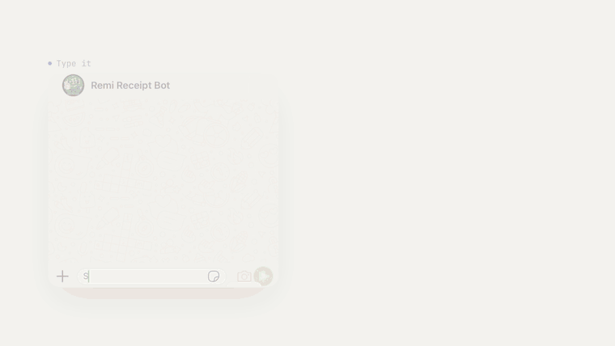
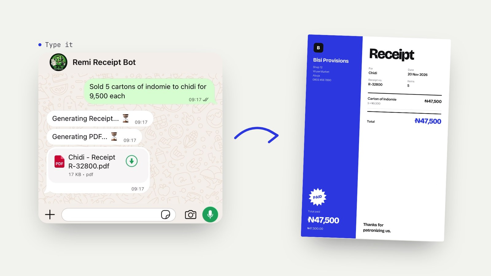
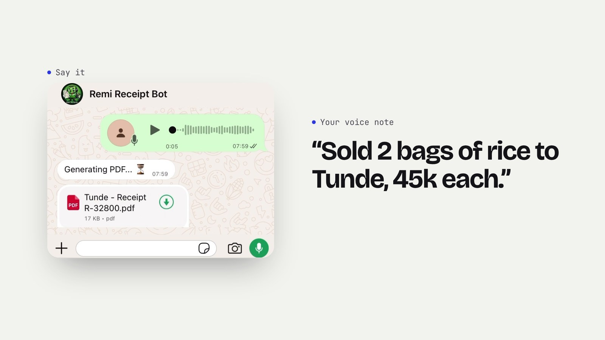
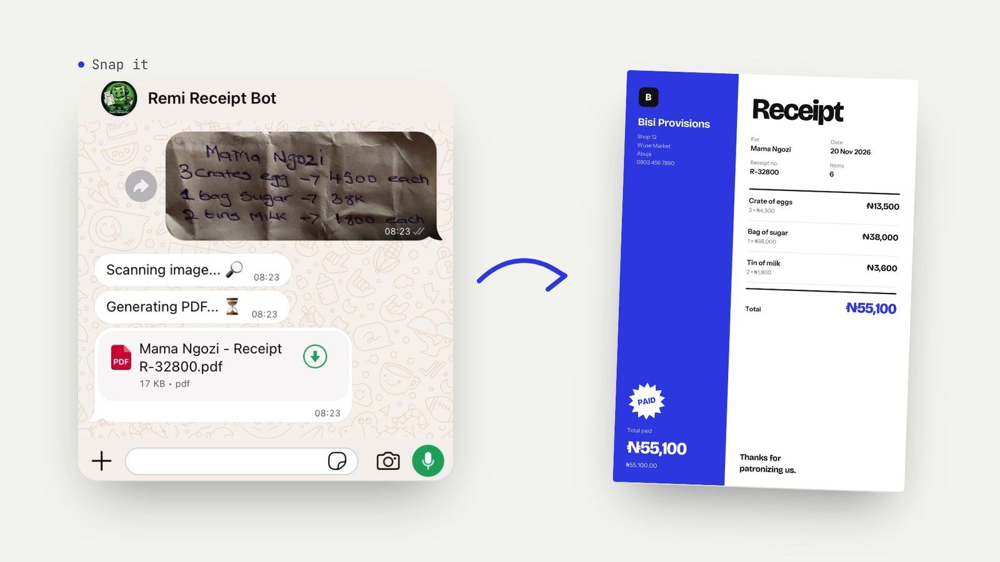
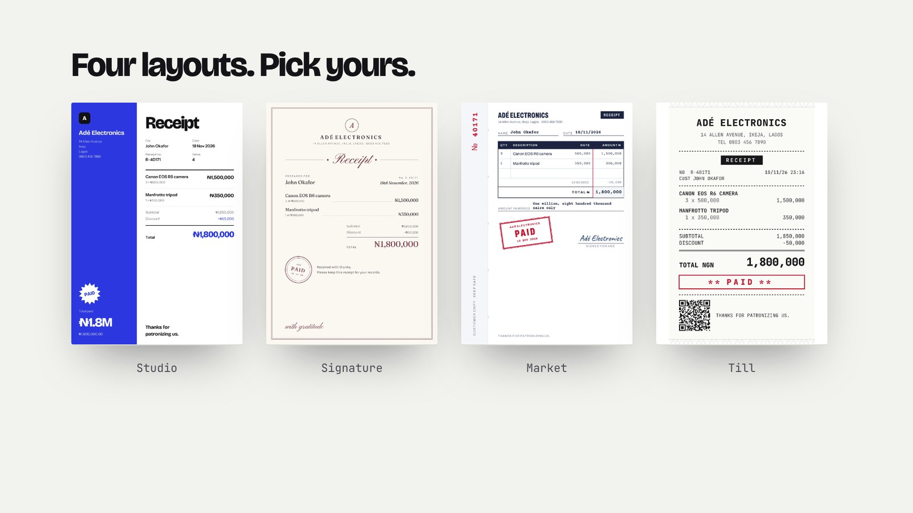

# Remi

Remi is a WhatsApp bot that writes receipts and invoices for small businesses. You tell it about a sale the way you'd tell a friend (a typed message, a voice note, or a photo of a handwritten list) and it sends back a proper PDF in a few seconds.

**Try it:** [remireceipts.web.app](https://remireceipts.web.app)

<p align="center">
  
</p>

## Three ways to log a sale

**Type it.** "Sold 5 cartons of Indomie to Chidi, 9,500 each" becomes a receipt for ₦47,500.



**Say it.** Send a voice note in plain speech. Remi works out the customer, the items and the prices.



**Snap it.** Take a photo of a handwritten list. Remi reads it and builds the receipt.



## What it does

- **Receipts and invoices** as PDFs, numbered and dated, with the amount written out in words.
- **Four layouts** (Studio, Signature, Market and Till), each with a receipt and an invoice version. Till is a narrow roll for shop counters and prints a QR code.
- **Your business on every page:** name, address, phone, bank details and logo.
- **Your currency**, picked from your phone's country code (₦, £, €, ₹, R, KSh, ₵, or $).
- **Fix it:** if Remi gets something wrong, tap "Fix it", say what to change, and it sends a corrected copy with the same number.
- **Teams:** the owner shares an invite code, staff join, and everyone's sales go into one ledger. The owner sees the team list and how much each member sold.
- **Sales reports:** ask for this week, this month, this year or all time, and get the totals, top customers and a chart.
- **Free and Premium:** 5 free receipts a month on the Studio layout. Premium unlocks everything, paid through [Bachs](https://bachs.io) in naira or dollars.



Full-size previews of each layout, receipt and invoice side by side: [Studio](public/layouts/v2/studio.png), [Signature](public/layouts/v2/signature.png), [Market](public/layouts/v2/market.png), [Till](public/layouts/v2/till.png).

## How it works

```
WhatsApp ──▶ /webhook ──▶ MessageRouter ──▶ handler ──▶ Gemini (reads the sale)
                                                    ──▶ PdfService (draws the layout)
                                                    ──▶ WhatsApp (sends the PDF)
                                                    ──▶ Firestore (profile, ledger)

Bachs ──▶ /bachs-webhook ──▶ SubscriptionHandler (adds 30 or 365 days of Premium)
```

1. Meta sends every incoming message to `routes/webhook.dart`. It checks Meta's signature, drops repeats and messages older than 10 minutes, then hands over to the router.
2. `lib/routing/message_router.dart` works out what the user wants. A sale goes to the receipt handler even if the user was halfway through a settings menu.
3. `lib/services/gemini_service.dart` turns text, audio or an image into a `Transaction`: customer, items, prices, and any notes the user wrote. It never makes up notes or terms.
4. `lib/services/pdf_service.dart` draws the chosen layout with the [`pdf`](https://pub.dev/packages/pdf) package. Each layout lives in its own folder under `lib/documents/`.
5. The PDF goes back through the WhatsApp Cloud API with a readable name such as "Chidi - Receipt R-32800.pdf", and the sale is written to the ledger with the name of whoever made it.

## Project layout

```
routes/
  webhook.dart            WhatsApp messages
  bachs-webhook.dart      Premium payments
  api/pricing.dart        Prices for the landing page
lib/
  routing/                Works out what each message is asking for
  handlers/               Receipts, settings, teams, stats, subscriptions
  services/               Gemini, Firestore, WhatsApp, PDF, Bachs
  documents/              The four layouts (studio, signature, market, till)
  models/                 Profiles, transactions, organisations
public/
  fonts/                  Fonts the layouts use
  layouts/v2/             Layout previews shown in the bot's menus
bin/
  generate_all_layouts.dart   Writes a sample PDF of every layout to samples/
```

## Running it

You need the Dart SDK (3.8 or later) and the [Dart Frog CLI](https://dart-frog.dev).

```sh
dart pub get
dart run build_runner build
dart_frog dev
```

To see every layout without WhatsApp:

```sh
dart run bin/generate_all_layouts.dart
```

### Environment variables

| Name | What it's for |
|---|---|
| `WHATSAPP_TOKEN` | WhatsApp Cloud API access token |
| `PHONE_NUMBER_ID` | The WhatsApp number Remi sends from |
| `VERIFY_TOKEN` | Token Meta uses when you register the webhook |
| `META_APP_SECRET` | Checks that messages really come from Meta |
| `GEMINI_API_KEY` | Google Gemini |
| `GEMINI_MODEL` | Which Gemini model to use |
| `GOOGLE_PROJECT_ID` | Firebase project that holds Firestore |
| `PUBLIC_BASE_URL` | The server's public address, for links to images |
| `BACHS_SECRET_KEY` | Bachs key (`sk_sandbox_…` for testing, `sk_live_…` for real payments) |
| `BACHS_PRODUCT_MONTHLY` | Bachs product for 30 days of Premium |
| `BACHS_PRODUCT_YEARLY` | Bachs product for 365 days of Premium |
| `BACHS_WEBHOOK_SECRET` | Checks that payment notices really come from Bachs |
| `LOG_LEVEL` | How much the server logs |

Firestore signs in with Google's default credentials, so the server needs a service account it can reach. Keep the key file out of the repo; `.gitignore` already excludes `service_account.json` and `.env`.

## Deploying

Remi runs on [Render](https://render.com) from the `Dockerfile`. The image compiles the server to a single native program ahead of time, which keeps it inside the free plan's 512 MB. The final image holds only that program and the `public/` folder.

Point Meta's webhook at `https://<your-server>/webhook` and Bachs's at `https://<your-server>/bachs-webhook`, listening for `collection.succeeded`.

## Built with

[Dart Frog](https://dart-frog.dev) · [WhatsApp Cloud API](https://developers.facebook.com/docs/whatsapp/cloud-api) · [Google Gemini](https://ai.google.dev) · [Cloud Firestore](https://firebase.google.com/docs/firestore) · [`pdf`](https://pub.dev/packages/pdf) · [Bachs](https://bachs.io) · Render

---

Made by Jeremiah Kehinde.
